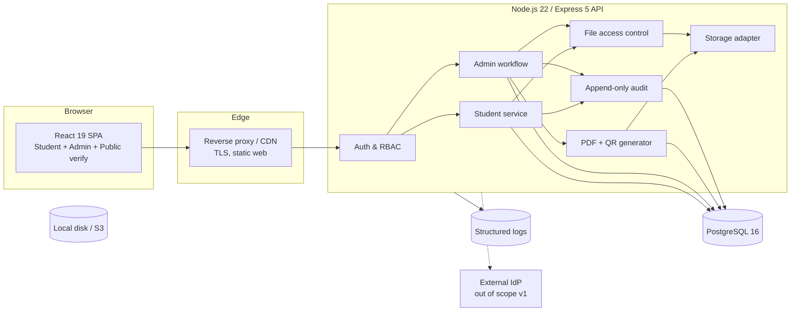
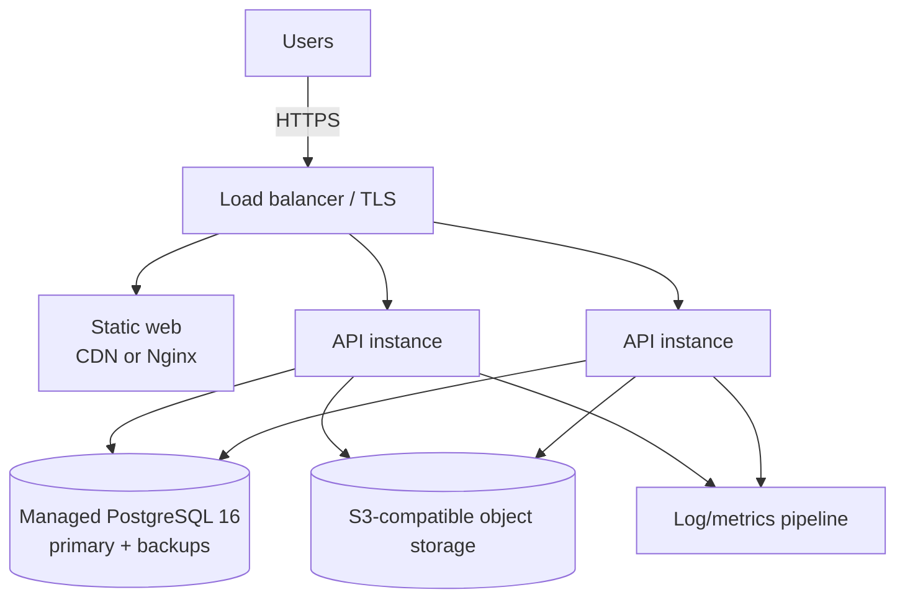

# Architecture

Status: Approved  
Last updated: 21 November 2026

## 1. Architectural drivers

- **Auditability over convenience.** Approval decisions are recorded in an append-only log and cannot be edited through the application or normal database writes.
- **Clear separation of duties.** A clerk verifies document consistency; only an HOD can make the final approval/rejection decision.
- **Small operational footprint.** A React SPA, a stateless TypeScript API, PostgreSQL, and a storage adapter. No background queue is required for v1; PDF generation is bounded and retried in-process.
- **Portable storage.** Local disk in development and S3-compatible object storage in production through one adapter.
- **Testability.** Database access is injected so integration tests can run inside rolled-back PostgreSQL transactions.

## 2. Technology decisions

| Concern    | Decision                                                                                    | Rationale                                                                                                                                                                                                                                             |
| ---------- | ------------------------------------------------------------------------------------------- | ----------------------------------------------------------------------------------------------------------------------------------------------------------------------------------------------------------------------------------------------------- |
| Web        | React 19 + Vite + TypeScript + Tailwind + shadcn/ui-style primitives                        | Required stack; fast builds; accessible composable components.                                                                                                                                                                                        |
| API        | Express 5 + TypeScript on Node 22                                                           | Required choice; mature middleware ecosystem and testability with Supertest.                                                                                                                                                                          |
| Database   | PostgreSQL 16                                                                               | Relational integrity, CHECK constraints, transactional workflows, row locking, triggers.                                                                                                                                                              |
| ORM        | **Drizzle ORM**                                                                             | SQL-first, fully typed queries, transparent migrations, no separate runtime client engine, and excellent fit for audit/DB constraint work. Prisma was rejected because its schema/generation layer adds indirection for a small SQL-centric workflow. |
| Validation | Zod 4                                                                                       | Shared request/form validation style and typed parsing at boundaries.                                                                                                                                                                                 |
| Auth       | Short-lived JWT access token + rotating opaque JWT refresh cookie backed by `auth_sessions` | Stateless verification for normal calls; server-side refresh revocation and reuse detection.                                                                                                                                                          |
| PDF        | `pdfkit` + `qrcode`                                                                         | Required library; deterministic server-side rendering without a browser dependency.                                                                                                                                                                   |
| Storage    | Local filesystem / AWS S3 (R2-compatible) adapter                                           | Meets development and production requirements while keeping access controlled by the API.                                                                                                                                                             |
| Tests      | Vitest, Testing Library, Supertest, Playwright, axe-core, k6                                | Required pyramid and quality gates.                                                                                                                                                                                                                   |
| CI         | GitHub Actions                                                                              | Required quality-gate automation.                                                                                                                                                                                                                     |

Detailed decisions live in [`docs/adr/`](./adr/).

## 3. Component diagram

An interactive, exportable version of this architecture is maintained in [`architecture-diagram.html`](./architecture-diagram.html) and generated with Archify. The editable source is [`architecture-diagram.archify.json`](./architecture-diagram.archify.json); both files are checked by CI.

## 4. Runtime and data flow

### 4.1 Student submission

1. Browser authenticates, receives a 15-minute bearer access token and `HttpOnly` refresh cookie.
2. `POST /api/student/requests` is multipart. Express memory storage caps the file at 5 MB.
3. The upload guard identifies the file by its magic bytes (PDF/JPEG/PNG), ignores the client-provided name, and writes a UUID-named object outside the web root through the storage adapter.
4. The API inserts the request and an audit event in one database transaction. If the DB transaction fails, the uploaded object is deleted (best-effort compensating cleanup).
5. The response includes the request and its timeline.

### 4.2 Staff verification and issuance

1. Clerk opens the queue and reviews the student master record and supporting document streamed through an authenticated API route.
2. Clerk calls verify. A row lock prevents races; the transition writes `VERIFIED_DOCS` and status `UNDER_VERIFICATION`.
3. HOD reviews the evidenced request and calls approve with optional remarks.
4. The approval transaction locks the request, verifies the state, writes `APPROVED`, and commits the approval decision.
5. The API renders the certificate PDF (including QR) with up to three retries and writes it to storage.
6. The API records the certificate row (unique number and verification code), sets request `READY`, and appends `GENERATED_PDF`.
7. If generation fails after approval, the request stays `APPROVED`, a `GENERATION_FAILED` audit row is written, and a staff member with issuance rights can retry.

### 4.3 Public QR verification

The QR encodes `${PUBLIC_APP_URL}/verify/<verificationCode>`. The public SPA calls `GET /api/verify/:code`; the endpoint returns a minimal projection and a generic 404 for unknown codes. No public listing, file access, or PII beyond name/roll/programme is exposed.

## 5. Deployment topology

- API is stateless apart from the shared PostgreSQL session store for refresh tokens.
- Horizontal scale is achieved by running more API replicas. Local PDF rendering is CPU-bound; rate limiting and connection pool limits cap concurrency.
- Migrations run as a one-off release job before new API replicas receive traffic.
- Health: `/health/liveness` checks process; `/health/readiness` checks PostgreSQL.
- Web assets are built to `apps/web/dist`; API to `apps/api/dist`. Nginx example configuration is under `deploy/`.

## 6. Data model

The exact required columns are present. Additive tables/fields support authentication and PDF issuance:

- `student_credentials` — password hash, forced-change flag, last login; students do not store secrets in the master academic record.
- `auth_sessions` — rotated refresh-token hash, expiry, revocation timestamp, IP/user-agent for security investigation.
- `certificates` — one issued certificate per request with unique number, verification code, object key, generation metadata.
- `admin_users.must_change_password` — required to enforce the first-login password change.
- `audit_logs.actor_student_id` and nullable `actor_id` — required because a student submission is itself an audited transition, while `actor_id` intentionally references staff only. Exactly one actor identity is present per row.
- `audit_logs.action` adds `GENERATION_FAILED` to persist failed generation attempts as required by the error-handling mandate.
- `certificate_requests` retains the required core fields; issuance metadata is normalised into `certificates` rather than duplicated.

All foreign keys are explicit. `audit_logs` has a `BEFORE UPDATE OR DELETE` trigger that raises an exception. The seed/fixture teardown must disable the trigger only under controlled test tooling.

### Indexes

Required indexes are created for `students(roll_number)`, `students(email)`, `certificate_requests(student_id, status)`, and `audit_logs(request_id)`. Additional indexes support queue filters and token lookup: `certificate_requests(status, created_at)`, `audit_logs(actor_id)`, `auth_sessions(token_hash)`, and `certificates(verification_code)`.

## 7. API boundaries

- All endpoints are under `/api`.
- JSON error envelope: `{ "error": { "code": "...", "message": "...", "details"?: ... } }`.
- Authentication is a Bearer JWT access token. Refresh is cookie-only.
- Public verification is deliberately separate from authenticated student endpoints.
- OpenAPI contract: [`API.md`](./API.md) and [`openapi.yaml`](./openapi.yaml). Swagger UI is served at `/api/docs` when enabled.

## 8. Security boundaries and trust

- The browser is untrusted. Every object-level access re-checks ownership or role server-side.
- Uploaded bytes are untrusted: size checked before body parsing, magic bytes validated, randomized names, no static serving, download responses use `Content-Disposition: attachment` and a strict content type.
- Staff roles are read from the database on each request; token role claims are checked but not trusted solely for authorisation.
- Database credentials, JWT secrets, seed passwords, and S3 keys are environment variables validated at startup. Production refuses weak or missing secrets.
- The audit table is append-only for normal roles via trigger; migration/DB administrator access remains a documented break-glass capability.
- Public verification rate limiting and generic not-found responses resist enumeration.

## 9. Error handling and resilience

- Central Express error middleware maps typed application errors to safe client messages.
- Startup validation fails fast on malformed config.
- PostgreSQL transient errors and certificate rendering/storage calls are retried up to three times with exponential backoff (base 100 ms in tests, 250 ms in production), with jitter.
- Failed generations are recorded as audit events. No request body, password, token, or document content is logged.
- Structured JSON logs include `requestId`, actor role (when known), method, path, status, and duration.

## 10. Testing architecture

| Layer       | Share | Tooling                     | Scope                                                                                                                                      |
| ----------- | ----- | --------------------------- | ------------------------------------------------------------------------------------------------------------------------------------------ |
| Unit        | ~65%  | Vitest + Testing Library    | Pure validation, status transitions, formatting, token helpers, PDF content builders, UI components.                                       |
| Integration | ~25%  | Supertest + PostgreSQL 16   | Real routes, auth/RBAC, DB constraints, uploads, workflow, audit immutability, security cases. Each test is wrapped in `BEGIN`/`ROLLBACK`. |
| E2E         | ~10%  | Playwright + POM + axe-core | Student → clerk → HOD → PDF/verify journey and accessibility.                                                                              |
| Performance | gate  | k6                          | 50 student + 10 admin VUs; P95 < 500 ms, error rate < 1%.                                                                                  |

Coverage thresholds are enforced in CI: 80% global lines, 90% for auth/workflow/data integrity files. E2E screenshots/traces and coverage reports are uploaded as artifacts.

The pipeline in [`.github/workflows/ci.yml`](../.github/workflows/ci.yml) runs three blocking jobs against a PostgreSQL 16 service container:

1. **Quality** — `lint`, `typecheck`, production `build`, `test:coverage` (unit, integration, and security suites), documentation presence, and the `SECURITY.md` sign-off gate.
2. **E2E** — Playwright Chromium with the deterministic E2E fixture and axe checks; ephemeral JWT secrets and E2E admin password are generated for the run.
3. **Performance** — the API is built, the E2E fixture is loaded, and the k6 profile runs with 50 student and 10 admin virtual users, failing on P95 ≥ 500 ms or error rate ≥ 1%.

Branch protection must require all three jobs before merging to `main`. CI does not use committed secrets and cannot deploy from this repository; production release steps remain in [`RUNBOOK.md`](./RUNBOOK.md) §8.

## 11. Risks and trade-offs

| Risk                                                                           | Mitigation                                                                                                                               |
| ------------------------------------------------------------------------------ | ---------------------------------------------------------------------------------------------------------------------------------------- |
| Synchronous PDF generation blocks the API for a short time                     | Small PDFs, bounded concurrency, retries, future queue migration documented. Queue is deliberately out of v1 scope.                      |
| Local disk not durable/shared                                                  | Production uses S3; readiness docs require S3 configuration.                                                                             |
| Refresh cookie cross-site deployment                                           | Frontend and API should share a site; `SameSite=Lax`, strict CORS allowlist, secure cookies. If truly cross-site, use a same-site proxy. |
| Enumerable roll numbers / seed default passwords                               | Forced change, rate limits, bcrypt, production seed password from env, no student listing endpoint.                                      |
| Audit table append-only is enforced at DB trigger, but DB owner can disable it | Restrict production DB owner/migration credentials; operational separation and review.                                                   |
